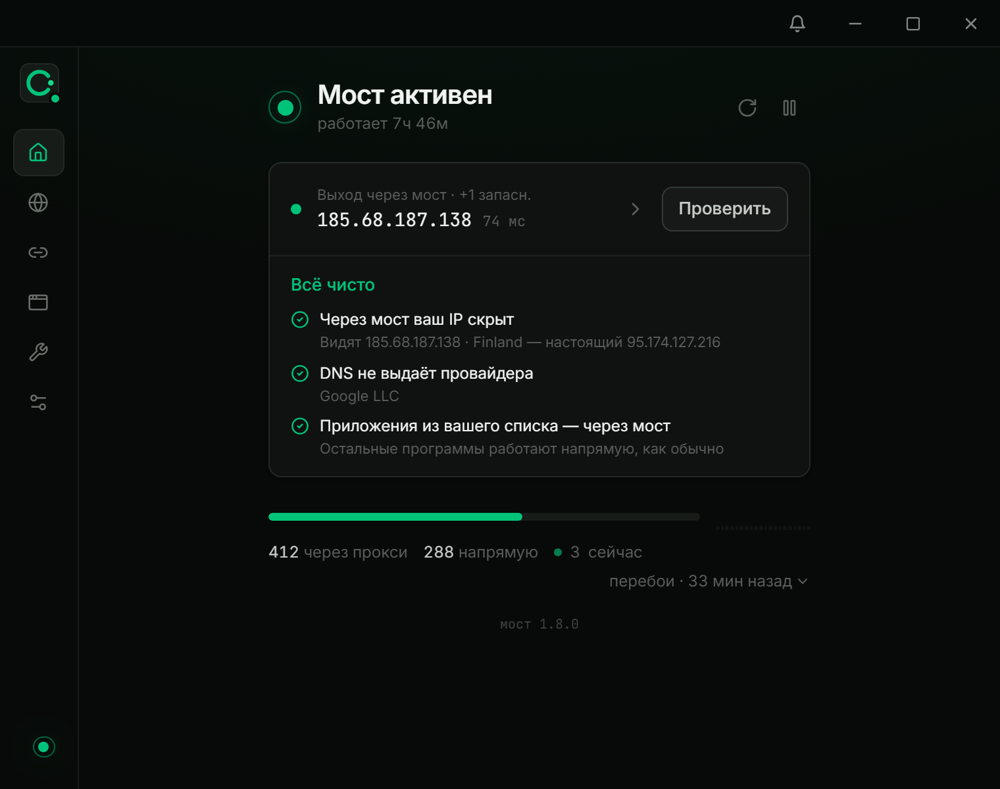
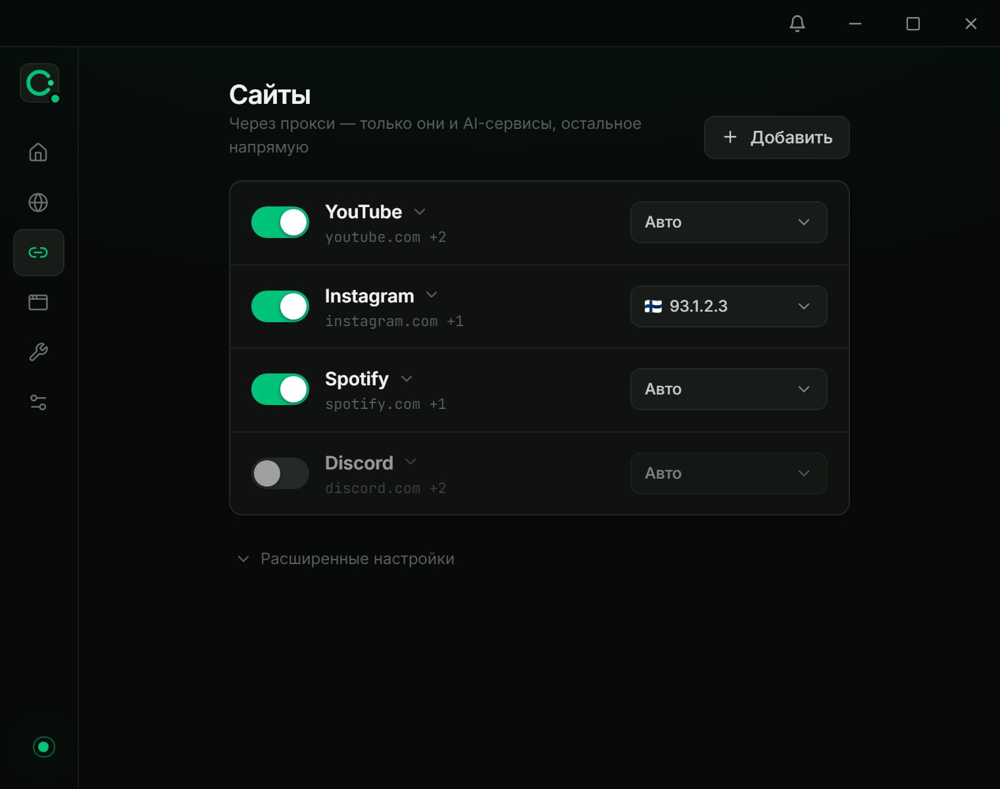
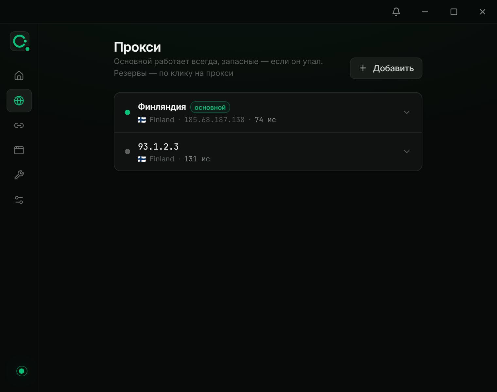
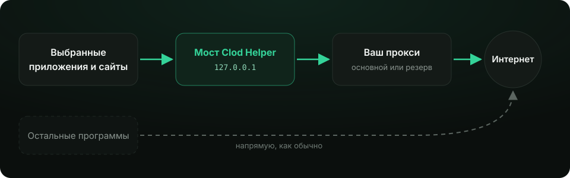

<div align="center">


# Clod Helper

**Свой прокси — только для тех программ и сайтов, которым он нужен.**<br/>
Остальное работает напрямую, как обычно.

<p>
  <a href="https://github.com/iimperium-dev/ClodHelper/releases/latest"></a>
  
  <a href="LICENSE"></a>
</p>

[**Скачать**](https://github.com/iimperium-dev/ClodHelper/releases/latest) · [Возможности](#возможности) · [Как это работает](#как-это-работает) · [Установка](#установка) · [Вопросы](#частые-вопросы)

<br/>



</div>

<br/>

## Зачем это

Системный прокси или VPN гонят через себя **весь** компьютер: медленнее, дороже по трафику, а банки и местные сервисы начинают ругаться на чужую страну. Ручная настройка прокси в каждой программе — долго, и половина программ её не поддерживает.

**Clod Helper** делает иначе: вы выбираете приложения и сайты, и через ваш прокси идут только они. Всё остальное — напрямую. Один раз добавили прокси — дальше программа следит за ним сама.

<br/>

## Возможности

<table>
<tr>
<td width="50%" valign="top">

### 🎯 Прокси для отдельных приложений
Добавьте программу — и она ходит через прокси. Остальные программы работают напрямую. Папки, сетка или список, поиск по установленным программам.

</td>
<td width="50%" valign="top">

### 🌐 Сайты через прокси
YouTube, Instagram или любой свой сайт — через прокси во **всех браузерах** сразу или только **в выбранных**. Остальные сайты открываются напрямую, без задержек.

</td>
</tr>
<tr>
<td valign="top">

### 🔁 Резервные прокси
До 5 прокси в пуле и до 5 резервов у каждого. Упал прокси — трафик сам переходит на резерв, ожил — возвращается обратно.

</td>
<td valign="top">

### 📌 Закрепление IP
Закрепите программу или сайт за конкретным прокси — выходной IP не будет меняться, пока вы сами этого не захотите.

</td>
</tr>
<tr>
<td valign="top">

### 🛡️ Защита от утечек
Системный брандмауэр не выпускает выбранные программы мимо прокси: если прокси упал, они остаются без сети, а не уходят напрямую с вашего IP.

</td>
<td valign="top">

### 🔍 Честный статус
Проверка выходного IP, утечки DNS и каждого прокси настоящим запросом. Страна, флаг и пинг — прямо в списке.

</td>
</tr>
<tr>
<td valign="top">

### ⌨️ Терминал и редакторы
Командная строка и инструменты разработчика — через прокси одним переключателем: только нужное или весь трафик.

</td>
<td valign="top">

### ✍️ Подписанные обновления
Обновление в один клик. Каждый релиз подписан ключом разработчика — программа не поставит подменённый файл.

</td>
</tr>
</table>

<br/>

<div align="center">
  
  
</div>

<br/>

## Как это работает

<div align="center">
  
</div>

Clod Helper ставит на компьютер маленький локальный **мост**. Выбранные программы и браузеры отправляют трафик в него, а мост передаёт его вашему прокси — с логином и паролем, без настройки в каждой программе. Мост сам следит за прокси, переключается на резерв и запускается вместе с системой.

Поддерживаются **HTTP** и **SOCKS5** прокси с авторизацией: `http://логин:пароль@ip:порт`.

<br/>

## Установка

| | Windows 10 / 11 | macOS 11+ (Apple Silicon и Intel) |
|---|---|---|
| **Файл** | `Clod.Helper_*_x64-setup.exe` | `Clod.Helper_*_universal.dmg` |
| **Скачать** | [Последний релиз →](https://github.com/iimperium-dev/ClodHelper/releases/latest) | [Последний релиз →](https://github.com/iimperium-dev/ClodHelper/releases/latest) |

1. Скачайте установщик для своей системы и запустите его.
2. Откройте Clod Helper и вставьте строку своего прокси.
3. Добавьте приложения и сайты, которым нужен прокси. Готово.

<details>
<summary><b>Windows пишет «Система защитила ваш компьютер»</b></summary>
<br/>

Программа не подписана платным сертификатом Microsoft, поэтому SmartScreen осторожничает. Нажмите **Подробнее → Выполнить в любом случае**. Если файл не запускается — ПКМ по нему → **Свойства** → галочка **«Разблокировать»** → **ОК**.

</details>

<details>
<summary><b>macOS не открывает программу</b></summary>
<br/>

Приложение не заверено Apple. ПКМ по Clod Helper в «Программах» → **Открыть** → **Открыть**. На macOS 15 и новее: **Системные настройки → Конфиденциальность и безопасность → «Всё равно открыть»**.

</details>

<br/>

## Где взять прокси

Подойдёт любой HTTP или SOCKS5 прокси с логином и паролем в нужной вам стране.

- **Купить готовый** — например, на [proxy6.net](https://proxy6.net/?r=692907) (реферальная ссылка автора: так вы поддерживаете проект).
- **Поднять свой** на недорогом VPS: Ubuntu + [3proxy](https://github.com/3proxy/3proxy), логин с длинным паролем, нестандартный порт. Свой IP будет только у вас.

<br/>

## Частые вопросы

<details>
<summary><b>Антивирус удалил или заблокировал файл</b></summary>
<br/>

Мост — небольшая программа, через которую идёт трафик, и некоторые антивирусы ложно принимают её за угрозу. Clod Helper сам вернёт мост из своей копии, а если антивирус удаляет его снова — покажет по шагам, как разрешить файл и добавить исключение. Исходный код открыт в этом репозитории.

</details>

<details>
<summary><b>Меняет ли программа системные настройки сети?</b></summary>
<br/>

Только когда вы сами включаете соответствующую функцию: «Сайты во всех браузерах» ставит системную автонастройку прокси, «Защита от утечек» — правила брандмауэра. Выключили — всё возвращается как было.

</details>

<details>
<summary><b>Что будет, если прокси перестанет работать?</b></summary>
<br/>

Если у прокси есть резервы — трафик перейдёт на первый живой и вернётся, когда основной оживёт. Если резервов нет — закреплённые программы подождут: IP без вашего ведома не меняется. С защитой от утечек они не уйдут в сеть напрямую.

</details>

<details>
<summary><b>Видит ли кто-то мой трафик?</b></summary>
<br/>

Мост работает только на вашем компьютере (`127.0.0.1`) и никуда, кроме вашего прокси, трафик не отправляет. Логин и пароль прокси хранятся локально.

</details>

<br/>

## Для разработчиков

<details>
<summary><b>Сборка и проверки</b></summary>
<br/>

Стек: **Tauri 2 · React 19 · Tailwind 4 · Framer Motion**, бэкенд и мост — на **Rust**.

```bash
npm install
npm run tauri dev          # разработка
npm run tauri build        # релизная сборка
npm run mock               # стенд интерфейса без Tauri (mock.html)
```

На Mac (нужны Xcode Command Line Tools):

```bash
npm run bridge:build:mac
npm run tauri build -- --target universal-apple-darwin
```

Проверки:

```bash
cargo test --manifest-path src-tauri/Cargo.toml --lib
cargo test --manifest-path bridge/Cargo.toml
npm run test:ui            # тесты интерфейса (Playwright, стенд mock.html)
```

Снимки для этого README: `npm run mock` в одном окне, затем `node scripts/readme-shots.mjs`.

</details>

<details>
<summary><b>Релизы и «Что нового»</b></summary>
<br/>

Релиз собирает GitHub Actions по тегу `vX.Y.Z` (Windows `.exe` и universal `.dmg`) черновиком; `scripts/publish-release.mjs` подписывает манифест обновлений `latest.json` ключом ed25519 и публикует релиз.

Пункты версии — в [`src/whats-new.json`](src/whats-new.json): строка — для всех систем, объект — только для указанных.

```json
"0.9.0": { "items": [
  "Общее для Mac и Windows",
  { "text": "Только для Windows", "platforms": ["windows"] }
] }
```

Если для системы в версии нет ни одного пункта, программа на ней это обновление не предлагает.

</details>

<br/>

## История звёзд

<a href="https://star-history.com/#iimperium-dev/ClodHelper&Date">
  
</a>

<br/>

<div align="center">

[MIT](LICENSE) · сделано с ❤️ для тех, кому нужен прокси, но не для всего компьютера

</div>
